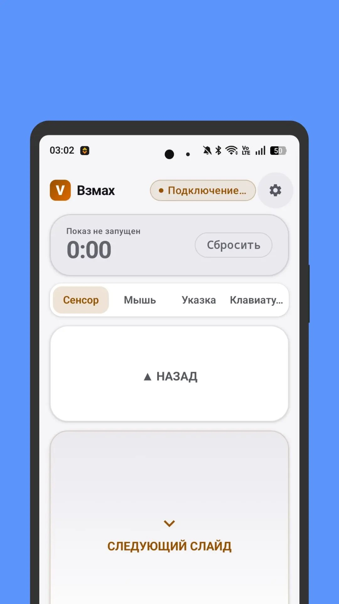
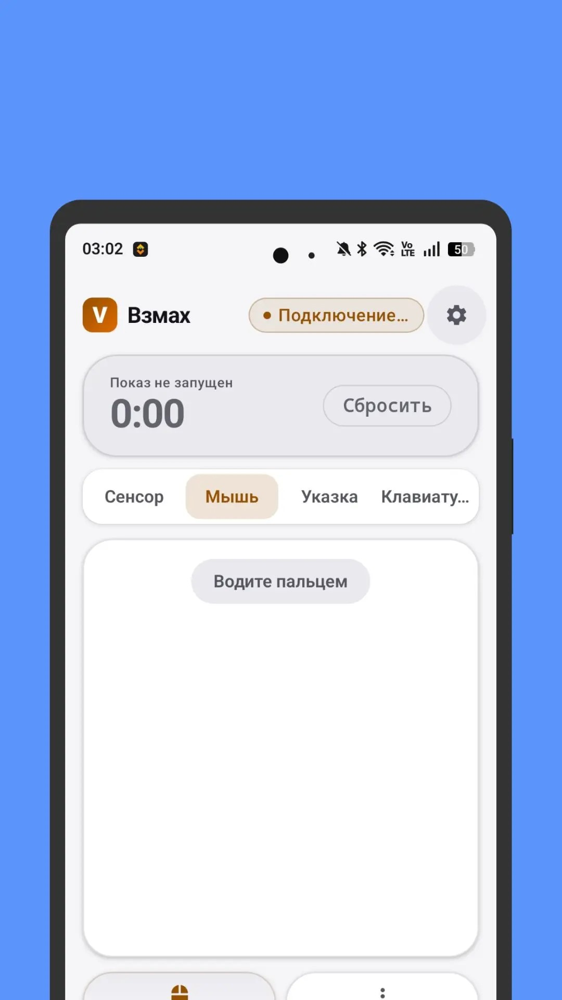
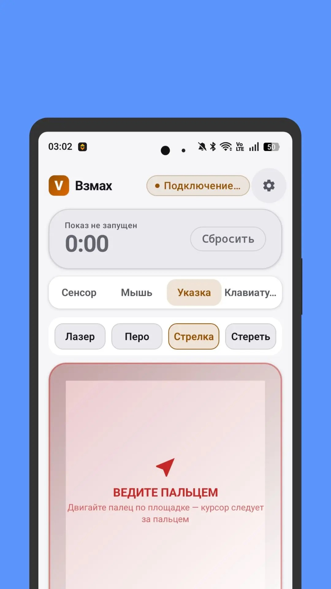
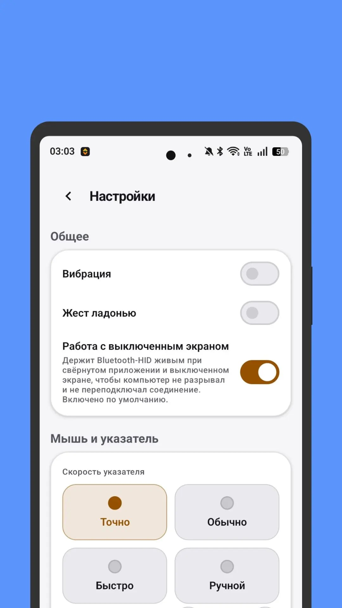

# Взмах (Vzmah)

**Bluetooth HID-пульт для презентаций.** Телефон превращается в тачпад, лазерную
указку и клавиатуру для компьютера — без установки чего-либо на сам компьютер.

Взмах подключается к ПК как обычная Bluetooth-клавиатура или мышь (профиль
HID HOGP). Команда уходит напрямую с телефона на компьютер по Bluetooth: ни
серверов, ни облака, ни агента на ПК. Работает офлайн.

> Статус: `0.1.0` — ранняя версия. Разработка ведётся публично, API и
> поведение могут меняться.

---

## Скриншоты

|  |  |  |  |
|:---:|:---:|:---:|:---:|
| **Сенсор**<br>крупные кнопки листания | **Мышь**<br>тачпад с подсказками | **Указка**<br>лазер, перо, стрелка, ластик | **Настройки**<br>скорость, жесты, фон |

---

## Возможности

### Четыре режима

| Режим | Что делает |
| --- | --- |
| **Сенсор** | Крупные кнопки «Назад» / «Следующий слайд». Листает слайд и без нажатия: проводом ладонью над датчиком приближения. |
| **Мышь** | Полноценный тачпад: движение пальца — курсор, тап — клик, удержание — перетаскивание, два пальца — прокрутка и правый клик. Отдельные кнопки ЛКМ и ПКМ. |
| **Указка** | Лазер, перо, стрелка и ластик для выделения на слайдах. Пресеты горячих клавиш под PowerPoint, Google Slides и LibreOffice Impress. |
| **Клавиатура** | Печать текста напрямую в программу на компьютере. Модификаторы (Ctrl, Shift, Alt, Win) и кнопка «Язык», переключающая раскладку на ПК через Win+Пробел. |

### Панель показа

Нижняя панель — самые частые команды презентации:

- **Экран** (`B`) — скрыть/показать содержимое
- **Старт** (`F5`) — запуск показа с начала
- **С текущего** (`⇧F5`) — запуск с текущего слайда
- **Выход** (`Esc`) — выход из показа

### Связь с компьютером

- **Автоподключение** — приложение помнит до 12 ранее подключённых
  компьютеров и переподключается само: до 12 попыток с задержкой от 0,5 до
  15 секунд.
- **Работа с выключенным экраном** — фоновая служба держит Bluetooth-соединение
  живым, когда телефон в кармане и экран погашен, чтобы компьютер не разрывал
  связь. Включено по умолчанию, отключается в настройках.
- **Кнопка «Переподключить»** — ручной сброс соединения одним нажатием.
- **Инструкция подключения** — пошаговый диалог (4 шага) для первого
  сопряжения, написанный для неспециалистов.

### Уведомление и плитка

- **Служба в шторке** — уведомление с живым статусом подключения, временем
  сессии и тремя кнопками: «Назад», «Вперёд», «Экран». Управление показом
  доступно, не открывая приложение.
- **Плитка быстрых настроек** — «Взмах — пульт» в шторке Android. Один тап
  открывает пульт прямо во время выступления.

### Настройки

Отдельный экран настроек (кнопка-шестерёнка в шапке) с секциями:

- **Общее** — вибрация, «жест ладонью = следующий слайд», работа с
  выключенным экраном
- **Мышь и указатель** — пресет скорости (Точно / Обычно / Быстро / Ручной),
  курсор, скорость скролла, инверсия по вертикали
- **Показ** — пресет программы показа (PowerPoint / Slides / Impress / Без)
- **Помощь** — инструкция подключения

### Прочее

- **Локализация** — русский (по умолчанию) и английский.
- **Тёмная тема** — следует системной настройке.
- **Отклик вибрацией** на каждую команду (отключаемо).
- **Защитные состояния** — понятные сообщения вместо вылетов: Bluetooth
  выключен, нет прав на подключение, HID-профиль занят, устройство больше не
  сопряжено, компьютер не в сети.

---

## Как это работает

Взмах использует **стандартный профиль Bluetooth HID** — тот же, что у
обычной беспроводной клавиатуры. Когда телефон подключается, компьютер видит
его как HID-устройство и принимает нажатия без каких-либо настроек.

Следствия этого подхода:

- **Ничего не нужно ставить на компьютер** — работает с Windows 10/11, macOS
  и Linux из коробки.
- **Нет задержек** — команды идут напрямую по Bluetooth, без облака.
- **Раскладку определяет ОС компьютера** — телефон передаёт только коды
  клавиш. Поэтому кнопка «Язык» шлёт Win+Пробел и переключает раскладку на
  стороне ПК.
- **Bluetooth должен быть включён на обоих устройствах**, а телефон и ПК
  должны быть сопряжены (делается один раз).

---

## Требования

**Телефон**

- Android 9.0 (API 28) или выше
- Bluetooth с поддержкой HID Device
- Для жестов листания: гироскоп с акселерометром (жест «кивок») и датчик
  приближения (жест «проведите ладонью»). Без них приложение работает
  полностью — просто листать придётся кнопками.

**Компьютер**

- Bluetooth-модуль
- ОС с поддержкой Bluetooth HID: Windows 10/11, macOS, Linux
- Презентационная программа: PowerPoint, Google Slides, LibreOffice Impress,
  Keynote или любая другая, реагирующая на стрелки/пробел/F5

**Для сборки**

- JDK 17
- Android SDK 35
- Android Studio с поддержкой Android SDK 35 (или чистый Gradle)

---

## Подключение (один раз)

1. Включите Bluetooth на телефоне и на компьютере.
2. Откройте на компьютере настройки Bluetooth и оставьте окно открытым.
3. В приложении выберите компьютер и нажмите «Обновить список» — телефон
   появится в списке на ПК.
4. Нажмите на телефон в списке и подтвердите код сопряжения на обоих экранах.

Подробная инструкция есть и внутри приложения — кнопка «Инструкция
подключения» в настройках.

---

## Сборка

```bash
git clone https://github.com/mrKamanov/vzmah.git
cd vzmah
```

**Отладочный APK**

```bash
# Windows
gradlew.bat assembleDebug

# macOS / Linux
./gradlew assembleDebug
```

Результат: `app/build/outputs/apk/debug/app-debug.apk`

**Релизный APK**

```bash
gradlew.bat assembleRelease
```

**Тесты**

```bash
gradlew.bat testDebugUnitTest
```

---

## Структура проекта

```
app/src/main/java/com/vzmah/app/
├── MainActivity.kt              Точка входа, Compose-хост
├── VzmahApp.kt                  DI-контейнер приложения
├── data/
│   ├── bluetooth/               Bluetooth HID-менеджер, коды клавиш,
│   │                            память подключённых хостов
│   └── sensor/                  Жесты: акселерометр и гироскоп,
│                                фильтр шагов
├── domain/
│   ├── model/                   Пресеты указателя, команды показа,
│   │                            клавиатура, вектор движения
│   └── usecase/                 Жесты, тачпад, проход ладонью,
│                                отправка команд HID
├── service/
│   ├── PresentationService.kt   Фоновая служба, уведомление с кнопками
│   └── PresentationTileService.kt  Плитка быстрых настроек
└── ui/
    ├── control/
    │   ├── ControlScreen.kt     Основной экран: режимы, тачпад,
    │   │                        клавиатура, указка
    │   ├── ControlViewModel.kt  Состояние, настройки, HID-команды
    │   ├── SettingsScreen.kt    Экран настроек
    │   └── Haptics.kt           Виброотклик
    └── theme/                   Цвета, тема, типографика
```

Стек: Kotlin 2.0, Jetpack Compose (BOM 2025.01), Material 3, без сторонних
библиотек — только AndroidX.

---

## Конфиденциальность

Приложение работает полностью офлайн. Разрешения `INTERNET` нет, аналитики и
рекламных SDK нет. Подробности — в [PRIVACY.md](PRIVACY.md).

---

## Лицензия

Проприетарная лицензия, **не open source**. Исходный код можно просматривать
и использовать приложение в готовом виде, но копировать, распространять или
монетизировать — только с письменного разрешения автора.

Полный текст — в [LICENSE](LICENSE).

Вопросы и запросы на лицензирование: <https://github.com/mrKamanov/vzmah/issues>

---

## English

**Vzmah** is a Bluetooth HID presentation remote. Your phone becomes a
trackpad, a laser pointer and a keyboard for your computer — with nothing to
install on the computer itself.

It connects as a standard Bluetooth HID device (HOGP), the same profile as a
regular wireless keyboard. Commands go straight from the phone to the PC over
Bluetooth: no servers, no cloud, no desktop agent. Works fully offline.

**Features:** trackpad with two-finger scroll and drag, laser / pen / arrow /
eraser pointer with hotkey presets for PowerPoint, Google Slides and
LibreOffice Impress, on-screen keyboard with layout switching, one-tap
presentation controls (blank, F5, ⇧F5, Esc), auto-reconnect, background mode
that survives a locked screen, a Quick Settings tile, notification controls,
and Russian / English localization.

Requires Android 9+ and a PC with Bluetooth (Windows 10/11, macOS, Linux).

License: proprietary — see [LICENSE](LICENSE).
